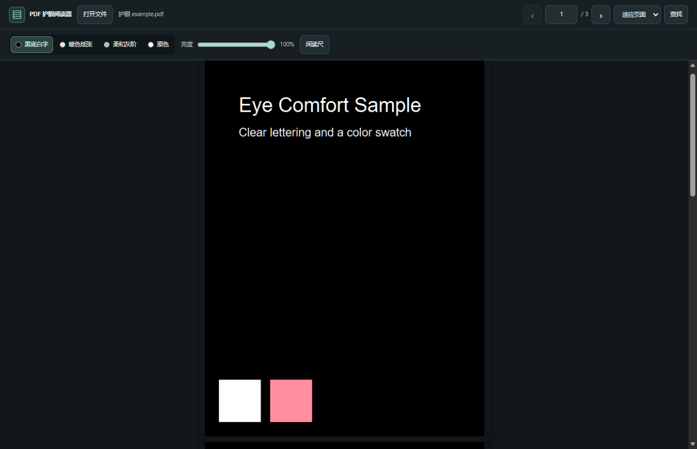
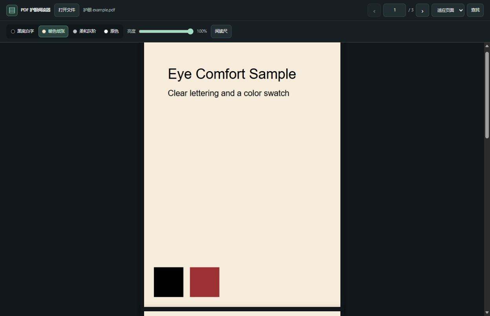

# PDF 护眼阅读器 · Microsoft Edge 扩展

用黑底白字读论文、电子书和长文档。白天可以切换暖色纸张或柔和灰阶，阅读时也可以单独调低 PDF 亮度，或用阅读尺跟住当前行。

**[下载最新版 PDF-Comfort-Edge.zip](https://github.com/auster2006/pdf-comfort-edge/releases/latest/download/PDF-Comfort-Edge.zip)** · [查看版本记录](https://github.com/auster2006/pdf-comfort-edge/releases)

## 安装

1. 下载上方的 `PDF-Comfort-Edge.zip` 并解压。
2. 在桌面版 Microsoft Edge 的地址栏打开 `edge://extensions`，开启「开发人员模式」。
3. 点击「加载解压缩的扩展」，选择解压后的 `PDF-Comfort-Edge` 文件夹。这个文件夹里应当直接看到 `manifest.json`。
4. 从 Edge 工具栏的「扩展」菜单打开 **PDF 护眼阅读器**。常用的话，可以把它固定到工具栏。

下载新版后，把新版文件解压到原来的扩展文件夹，在 `edge://extensions` 中点击扩展卡片上的「重新加载」。[Microsoft 官方安装指南](https://learn.microsoft.com/zh-cn/microsoft-edge/extensions/getting-started/extension-sideloading)

## 打开 PDF

| 文件在哪里 | 怎么打开 |
| --- | --- |
| 电脑里的 PDF | 点击扩展，选择「选择本地 PDF」，或把文件拖进阅读器。 |
| Edge 已打开的网页 PDF | 如果地址路径以 `.pdf` 结尾，点击扩展图标即可在新标签页阅读。 |
| 网页上的 PDF 链接 | 右键链接，选择「用 PDF 护眼阅读器打开」。也可以把地址粘贴到阅读器首页，适用于网址没有 `.pdf` 后缀的情况。 |

第一次读取某个网站时，按 Edge 提示授权。若下载链接需要登录或站点限制直接读取，可以先下载 PDF，再从阅读器里打开。若想从 Edge 已打开的本地 PDF 标签页直接切换，需要在扩展详情中开启「允许访问文件 URL」。选择或拖入本地文件时可直接使用。

## 阅读与调节

- **配色**：黑底白字、暖色纸张、柔和灰阶和原色可随时切换。配色只改变页面显示。查看图表或照片时，切换到「原色」并把亮度调回 100%，即可查看原有颜色。
- **亮度与阅读尺**：亮度滑块只调节 PDF 页面。打开阅读尺后，移动鼠标即可调暗当前位置上下的内容。扩展会在当前浏览器记住配色、亮度和阅读尺状态。
- **导航与搜索**：用页码框跳页，可选适应宽度、适应页面或固定缩放比例。`Ctrl+F` 搜索 PDF 的文本层。扫描件也可切换配色，搜索需要文件自带文本层。

查看暖色纸张模式

## 本地处理与源码

PDF 在 Edge 中渲染。本地文件可以离线阅读。打开网页 PDF 时，扩展从原网站读取文件，阅读偏好保存在当前浏览器。

克隆或下载源码后，也可以直接在 Edge 加载包含 `manifest.json` 的仓库根目录。项目附带 [Mozilla PDF.js](https://mozilla.github.io/pdf.js/)，无需安装依赖或执行构建。PDF.js 及随附资源的版本和许可见 [vendor/pdfjs](vendor/pdfjs/)。
